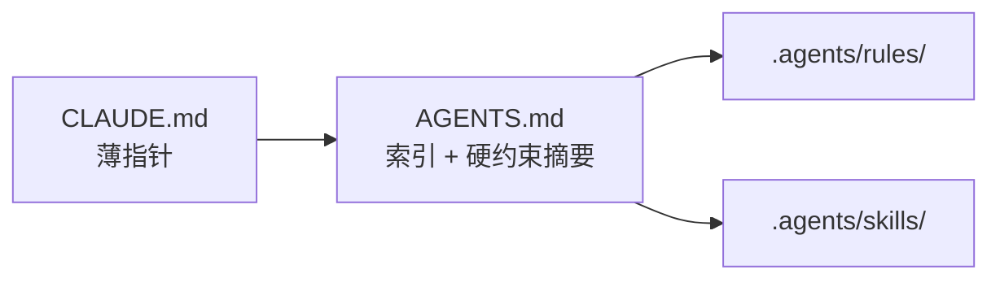

# CLAUDE.md 与 AGENTS.md 的关系

本文件规定 init / 迁移时如何处理根目录 `CLAUDE.md`，避免与 `AGENTS.md` + `.agents/` 双份维护。

## 职责分层（单一事实源）



| 文件 / 目录 | 职责 | 是否写架构正文 |
|-------------|------|----------------|
| `AGENTS.md` | 工作范围、约定摘要、Installed toolset、指向 rule/skill 的索引 | **否**（只留 2～4 条「详见」链接） |
| `.agents/rules/<name>/` | 项目解构、目录树、前后端架构、启动命令、硬约束 | **是**（bullet checklist） |
| `.agents/skills/<name>/` | 按需 SOP、模板、checklist | 流程类正文 |
| `CLAUDE.md` | Claude Code 等助手的兼容入口 | **否**，仅薄指针 |

## CLAUDE.md 规范（薄指针）

新建或迁移后的 `CLAUDE.md` 应约 **10～15 行**，只包含：

1. 说明：本仓库 AI 准则统一在 `AGENTS.md` + `.agents/`
2. 链接：`AGENTS.md`、`.agents/rules/`、`.agents/skills/`
3. 建议首次阅读顺序（如 `repo-structure` → `dev-workflow` → 按端 rule）

**禁止**在 `CLAUDE.md` 保留项目结构树、核心架构、命令速查等正文。

模板：[assets/templates/CLAUDE.md.tpl](../assets/templates/CLAUDE.md.tpl)。

## AGENTS.md 规范（索引型）

- **Overview**：一句话项目定位 + 指向 `.agents/rules/` 的阅读指引
- **Working directory / Language / Conventions**：保留 installer 锚点；内容保持短 bullet
- **Key patterns（推荐）**：2～4 条链接到对应 rule 文件，**不要**粘贴大段 Project-specific patterns
- **Installed toolset / Do not / Updating**：按标准模板
- **Do not** 必须含：不要再维护独立大段 `CLAUDE.md` 或双份项目解构

模板：[assets/templates/AGENTS.md.tpl](../assets/templates/AGENTS.md.tpl)。

## Init 时遇到已有 CLAUDE.md

检测根目录是否存在 `CLAUDE.md` 且体量明显超过薄指针（经验阈值：**> 30 行** 或含「项目结构」「核心架构」等章节标题）。若命中，**必须**用 `AskUserQuestion` 面板确认（不可静默覆盖）：

```yaml
questions:
  - header: CLAUDE 迁移
    multiSelect: false
    question: 检测到已有较长的 CLAUDE.md。如何整合进 AGENTS.md + .agents/？
    options:
      - label: 拆入 rules + 薄指针 (推荐)
        description: 将项目结构/架构/命令拆入 .agents/rules/ 对应文件；CLAUDE.md 改为薄指针；AGENTS.md 只保留索引。
      - label: 仅改为薄指针
        description: 不自动拆内容；CLAUDE.md 改为指向 AGENTS.md；原正文由用户自行迁移。
      - label: 暂不处理
        description: 保留现有 CLAUDE.md；在控制台 warning 提示存在双份维护风险。
```

### 选「拆入 rules + 薄指针」时的落点约定

| CLAUDE 常见章节 | 建议落入 |
|-----------------|----------|
| 项目结构 / 目录树 | `rules/<stack>/repo-structure.md` 或等价目录边界文件 |
| 后端架构 | `rules/<stack>/backend-*.md` |
| 前端架构 | `rules/<stack>/frontend-*.md` |
| 快速开始 / 常用命令 | `rules/<stack>/dev-workflow.md` |
| 关键约定（env / commit / 版本号） | `rules/<stack>/code-style.md` |

若项目尚无框架 rule，可先建 `.agents/rules/project-context/`（`overview.md` 等）再逐步收敛到框架 rule。文档风格：bullet checklist，代码示例仅保留最短必要片段。

## 兼容性说明

| 助手 | 主要入口 | 说明 |
|------|----------|------|
| Claude Code | 常读根 `CLAUDE.md` | 故保留薄指针，避免助手找不到入口 |
| Cursor / Codex / Trae | `AGENTS.md` + `.agents/` | 以本 skill 默认布局为准 |

双入口、**单正文**：薄指针可多份，架构正文只在 `.agents/rules/`。

## 反模式

- 在 `CLAUDE.md` 与 `AGENTS.md` 同时维护完整项目解构
- 在 `AGENTS.md` 写大段 Project-specific patterns / 代码块（应进 rules / skills）
- init 时静默删除或覆盖用户已有长 `CLAUDE.md`（必须面板确认）
- 把 `CLAUDE.md` 做成与 `AGENTS.md` 的全文同步副本（双份漂移）
